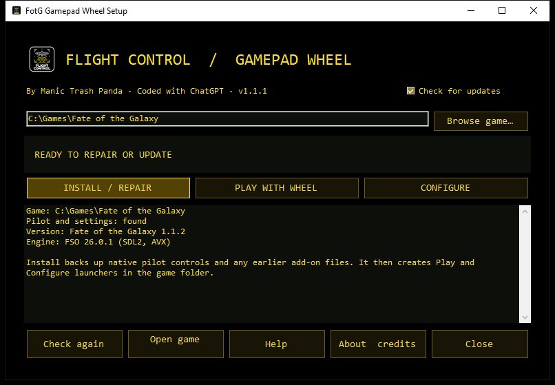

# Flight Control for Fate of the Galaxy

**Version 1.1.4 campaign utilities candidate.** A free, handheld-first controller add-on for the Windows release of Fate of the Galaxy: D-pad command wheels, tap/hold actions, gamepad-friendly menu navigation and a configurable layout. Internally the add-on is called **FotG Gamepad Wheel**.

Development began so the game could be played on a Legion Go 2 at launch, before it had gamepad support. Fate of the Galaxy gained native gamepad bindings along the way; Flight Control covers what individual bindings don't: more cockpit commands than a controller has buttons, and menus that still expect a mouse. The command wheels are inspired by MechWarrior 5 and adapted for FotG (no affiliation). The default layout is a tested starting point, not a rule: switch flight-axis presets, add long-press actions, rearrange the wheels and tinker with the macros.

- **Download the player build:** https://manictrashpanda.dev/games/FotGFlightControl/ (the ZIP with Setup.exe; this repository's automatic source ZIP does not contain the compiled programs)
- **Help:** https://manictrashpanda.dev/games/FotGFlightControl/help/
- **Report a problem:** [GitHub issues](https://github.com/wray2064/FotGFlightControl/issues) or dev@manictrashpanda.dev
- **Download safety:** [SECURITY.md](SECURITY.md) explains the 1.1.1 Defender alert and the changes in 1.1.2.

> Tested on a Lenovo Legion Go 2, ROG Ally X, Xbox controllers and generic gamepads, with Fate of the Galaxy 1.1.0, 1.1.1 and 1.1.2. Testing has focused extensively on practice missions, refining how the controls feel while flying. The campaign and multiplayer have not yet been tested. Bugs, awkward interactions and ideas for improvement: dev@manictrashpanda.dev.
>
> Unofficial fan tool. Not affiliated with or endorsed by the Fate of the Galaxy team, the FreeSpace Source Code Project, Lucasfilm or Disney. The game and engine are separate downloads and are not included here.

By **Manic Trash Panda**, coded with ChatGPT. Questions: **dev@manictrashpanda.dev**. See [About.html](About.html) for project and platform attributions.

The original add-on code, companion programs and documentation are released under the [MIT License](LICENSE). The original emblem may be used only with this tool under the [artwork terms](ARTWORK-LICENSE.md). The game and engine are separate downloads.

Contributions are welcome; see [CONTRIBUTING.md](CONTRIBUTING.md). For source builds and release packaging, see [docs/RELEASE.md](docs/RELEASE.md).

An independent, additive controller mod for **Fate of the Galaxy 1.1.0, 1.1.1 or 1.1.2** on Windows with its **FSO 26.0.1** engine (the standard SDL2 build, or the FSO 26.0.1-SDL3 package on older installs). The Lua addon draws four in-flight panels; a small XInput bridge supplies raw D-pad and right-stick input and adds menu navigation. The external Flight Control Console configures wheel layouts and macros, and backs up native pilot settings.

The [Flight Response](docs/screenshots/flight-response.jpg), [Macro Deck](docs/screenshots/macro-deck.jpg), [Advanced Layouts](docs/screenshots/advanced-layouts.jpg), [Button actions](docs/screenshots/button-actions.png) and [Custom axes](docs/screenshots/custom-axes.png) screenshots show the controller preview and configuration pages.

## Install

1. Install Fate of the Galaxy 1.1.0, 1.1.1 or 1.1.2 with its FSO 26.0.1 engine. Run the unmodified game once and create a pilot, then exit. Connect the gamepad before running Setup.
2. Extract the entire ZIP. Close the game and any older FotG controller companion.
3. Double-click **Setup.exe**. It finds common game locations; otherwise choose the folder containing `kn_portable` with **Browse game**. Click **Install / Repair**.
4. Open **Hangar Bay.exe** in the game folder. On Deploy, choose the base game or an installed mission pack, then launch Standard Flight or OpenXR VR. The original game launcher runs without Flight Control.
5. Use Hangar Bay **Console** for flight response, macros, axes, wheel text and button actions; **Service** for backups, repair and controller selection; and **Guide** for built-in help. Advanced wheel layouts can be shared as JSON profiles. Save Wheel and restart the game after wheel changes.

To switch controllers, close the game, open Hangar Bay **Service → Choose controller** (or Console → Flight Response), choose the XInput slot whose preview responds, and press **Apply with backup**. The console matches that slot to FSO's SDL joystick and saves both choices in the active game profile. Restart the game afterward. If SDL cannot identify which physical pad matches the slot, choose it from the device list. A disconnected saved slot stays disconnected in game instead of silently controlling the ship with another pad.

See the [step-by-step installation guide](docs/INSTALL.md) and [test checklist](docs/TESTING.md). Setup installs by itself and runs no scripts. Advanced users can run the same install from a command prompt: `Setup.exe --install --game "C:\path\to\Fate of the Galaxy"`.

The installer checks the game/engine version, copies only its own `GamepadMods/FotG_Gamepad_Wheel` directory, and creates two launchers. The wheel launcher uses a separate `GamepadMods_settings.ini` profile; installation identifies the connected controller through the engine's own SDL library (SDL2 or SDL3) and selects it in that profile, together with the order of its stick axes, backing up any prior profile. The Flight Control Console edits this active profile. The installer also backs up each existing native v4 pilot before reserving A, B, X, Y, LB, RB, Start, L3, R3 and D-pad joystick bindings; those inputs are delivered to the wheel instead. RT produces the normal mouse-primary-fire input in flight. Existing keyboard bindings, game scripts, engine, campaigns and saves remain in place. Add `--skip-pilot-reservation` to `Setup.exe --install` to install files without changing pilots, then press **Reserve wheel buttons** in the console for each pilot before testing.

## Controls

| Input | In flight | In menus |
|---|---|---|
| D-pad down | Tap for squad commands; hold to look rear | Next item / Down |
| D-pad up | Tap for ship systems; hold to look up | Previous item / Up |
| D-pad left | Tap for targeting; hold to look left | Previous item / Left |
| D-pad right | Tap for macros; hold to look right | Next item / Right |
| Right stick | Select wheel segment | Move pointer |
| A | Confirm selection; target ship in reticle when wheel closed | Activate selection; click after stick movement |
| B | Target closest attacker; cancel an open wheel | Back/Escape |
| RT | Primary fire when wheel closed | Mouse click |
| LT | Secondary fire when wheel closed | No menu action |
| Left stick | Native flight controls | Move pointer |
| X / Y | X cycles the selected target class; hold Y for the B-wing or T-Blade's third gun | Enter / Backspace |
| LB / RB | LB cycles secondary banks; RB changes ship mode | Previous / next tab |
| L3 / R3 | Match target speed / cycle subsystems on the targeted ship | No menu action |
| Start / Menu | Tap to pause; hold 500 ms to cycle Cockpit → Chase → External | Enter |

The main menu uses discrete D-pad selection with a visible cursor highlight. Other menus receive arrow key taps, while A sends Enter after D-pad navigation. After moving either stick, A clicks at the pointer; RT always clicks. LB/RB send Shift+Tab/Tab. This keeps the game's pointer-only controls accessible without a touchpad or finger mouse.

In flight, a short D-pad release opens its wheel. Holding a direction starts the matching view after the configured delay (250 ms by default), and releasing centers the view. The Macro Deck slider sets the delay from 150 to 600 ms. **Disable look around** makes every D-pad press open a wheel immediately. Menus retain immediate navigation. Save Wheel and restart the game after changing this setting.

**Hold Menu cycles camera** is enabled by default and can be turned off on the Macro Deck page. Each hold advances Cockpit → Chase → External → Cockpit; a short press still pauses. **Buttons...** on the Macro Deck page sets the action of each face button, bumper and stick click: a quick-press action for A, B, X, Y, LB, RB, L3 and R3, and an optional long-press action (250–1000 ms) for all of them except Y. Choices: targeting (reticle, attacker, next in class, nearest enemy or friendly, target's target, newest ship, bombs, subsystems, turrets, clear), match speed, weapon and ship-mode cycling, afterburner and the B-wing/T-Blade third gun (both while held), countermeasures, energy presets, transfers and +/- steps, full or zero throttle, chase and external views, HUD toggle, radar range, nav points, autopilot, and the boarding party task. Actions marked *while held* repeat as long as the button is down. A and B still confirm and cancel while a wheel is open, and the D-pad, Menu, sticks and triggers keep their roles. The defaults are the 1.0 layout. The squad command wheel includes **Cycle boarding party task** during Assault missions, matching the game's keyboard 4 action. It is also available as a custom hold or macro action.

LB cycles the selected secondary bank for LT. Y fires the third primary gun directly on B-wings and T-Blade bombers and restores the previously selected bank afterward; Y has no flight action on other ships. RB changes the ship's available control mode: Falcon gun control, TIE-family burst fire, S-foils on equipped ships, or targeting computer mode on other ships with secondary weapons. The game's mission restrictions still apply. A targets the ship under the reticle, B targets the closest ship attacking you, and X cycles the ship class chosen on the targeting wheel (enemies by default). Choosing a class does not immediately change the target. The targeting wheel also clears the ship target, switches between a subsystem and the hull, targets a subsystem in the reticle, and cycles live turrets on the current ship. Subsystem actions are disabled when the selected ship has no eligible parts; R3 cycles subsystems directly.

**Flight Axes** defaults to **Classic direct (tested)**. It restores the earlier handheld layout using the engine's gamepad axes: right stick yaw/pitch; left stick roll/relative throttle. Choose **Classic inverted pitch** to reverse only the right stick's vertical steering. The stock 1.1 default instead binds yaw/pitch to the left stick, roll to right stick Y, and no throttle axis. The mod builds two named presets from the installed 1.1 control table and does not edit the game's table. Choose **Game's saved setup** in the console to stop applying a classic preset. The older profile used sensitivity 5 and deadzone 10%; set those on the Flight Response tab and apply with backup for the closest v1 comparison. The classic presets reserve A, B, X, L3, R3, LB, RB, Y and Start for the mod's context-aware actions. Existing custom button bindings may need to be reapplied after enabling Classic.

The wheel confirms dangerous depart/warp orders twice. The command panel uses `mn.CommItems` and native `selectItem()` so mission restrictions and FotG order hooks remain in effect. The targeting subsystem macro checks visibility, team, targetability and remaining subsystem health and is limited to single player. Energy presets are likewise limited to single player. An unavailable action displays a message instead of guessing an order.

Wheel labels now have near-opaque dark backplates, bright text and a clear amber selection border so combat effects do not wash them out. **Wheel Text** in the console selects the game's existing 20 px or 30 px font and regular or bold weight. The default is 20 px bold. Large text may occupy more of the screen on low resolutions; switch back to Medium if needed.

## Custom flight axes

Choose **Custom axes** under **Flight Axes** and press **Edit axes...** to pick the stick axis (left or right stick, left/right or up/down, or none) for yaw, pitch, roll and relative throttle, each with an invert option. **Save Wheel** writes a fourth preset, `FotG Custom`, next to the two Classic presets in the add-on's `Controlconfigdefaults.tbl`; Install / Repair keeps it. Button actions and the axis map travel in exported profiles (profile version 2; version 1 profiles still load). **Game's saved setup** leaves everything to the game's own Controls menu.

## Updates

Setup and the console check `https://manictrashpanda.dev/games/FotGFlightControl/update.json` when they open. When a newer release exists, Setup shows **Update to x.y.z**: it downloads the ZIP only from the product site or this repository's GitHub releases, checks its size and SHA-256 against the manifest, extracts it under `%LOCALAPPDATA%\Manic Trash Panda\Flight Control\Updates`, and shows the new Setup.exe in File Explorer. Close Setup, run the new one and choose Install / Repair; Flight Control never starts a downloaded program itself. The manifest can also list newer game versions checked with a given Flight Control build; Setup then installs for them without the override warning. The check sends only the HTTPS request (with a `FlightControl/<version>` user agent) and can be turned off with **Check for updates** in Setup. The builds are not code-signed yet, so Windows may warn about an unknown publisher.

## Restore and remove

The console's **Restore latest backup** restores the selected pilot and matching FotG settings INI from a timestamped copy under `kn_portable/HardLightProductions/FreeSpaceOpen/ControllerSetupBackups`. Restore any pilots whose reserved controls you want back before removing the addon. Delete `GamepadMods/FotG_Gamepad_Wheel` and the two wheel launchers to remove it. The original game's launcher remains available.

## Test status

Source is included. Build and offline checks passed. On a Legion Go 2, testing confirmed that the repaired Classic direct preset restores right-stick yaw/pitch and left-stick roll/throttle in the practice mission. The prior failure was traced to a stale SDL2 joystick GUID in the wheel profile and a raw SDL3 joystick axis mapping applied to FSO's canonical SDL3 gamepad axes. The installer now detects the connected controller through the engine's own SDL library. Classic inverted pitch is generated and selectable, but has not yet had a physical flight test. Issuing an actual squad order, all four panels, macro effects, broader mission compatibility, and multiplayer behavior still need review. Some mission-specific screens may still require stick pointer control. Fate of the Galaxy 1.1.1 and 1.1.2 are also supported. They use the same packages and launch flags as 1.1.0. Flight Control runs on the FSO 26.0.1 engine Knossos installs for Fate of the Galaxy: the standard SDL2 build (SSE2, AVX or AVX2, whichever this PC runs) on a clean FotG 1.1.1 or 1.1.2 install, or the FSO 26.0.1-SDL3 package where an install from FotG 1.1.0 still has it. On SDL 2.26.5 an Xbox controller reports its sticks as raw axes 0-3 and its triggers as 4-5, the same numbering as the SDL3 build; the installer reads the order from the connected pad and records it in `engine-axes.txt`. Knossos may install 1.1.2 as one merged `data` folder instead of one folder per package; the launcher and preset builder handle both layouts. 1.1.2's default controls list the roll axis as unbound, so the builder replaces any axis entries the game already has instead of adding duplicates; the generated Classic presets are identical to 1.1.1's. Install and in-game play have been confirmed on 1.1.1 and 1.1.2. If the game is updated to a version this build doesn't list, Setup shows **Unsupported game version** and offers **Override version check**. Ticking it installs for that version anyway, after a warning: compatibility cannot be guaranteed while the override is in use, until Flight Control is updated for that version. Setup still checks the game's control defaults first and changes nothing if they are in a layout it doesn't recognise. From a command prompt, the same is `Setup.exe --install --game <folder> --game-version <version> --override-version-check`. Tested on a Lenovo Legion Go 2, ROG Ally X, Xbox controllers and generic gamepads, with Fate of the Galaxy 1.1.0, 1.1.1 and 1.1.2. Testing has focused extensively on practice missions, refining how the controls feel while flying. The campaign and multiplayer have not yet been tested. Reports from campaign missions and your own configurations are welcome at dev@manictrashpanda.dev.
