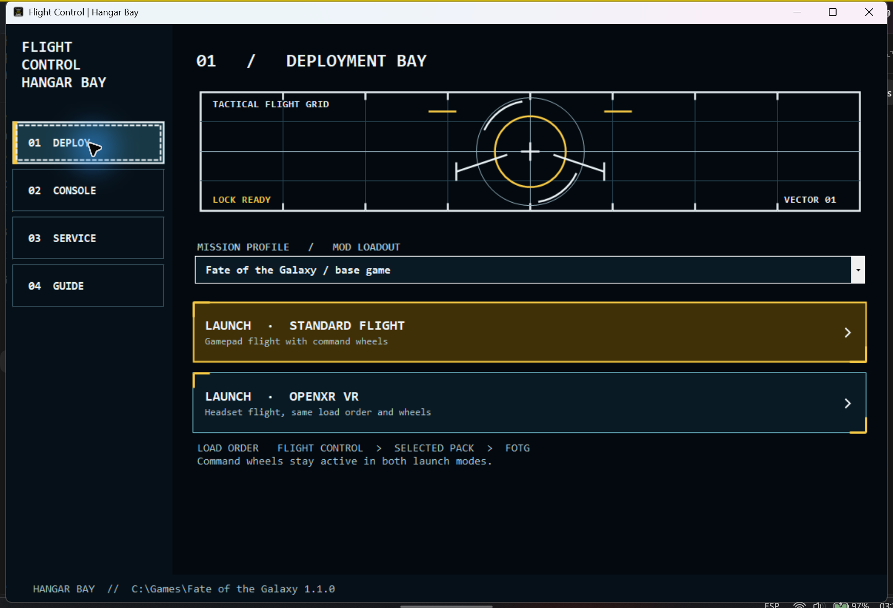

# Install Flight Control and use Hangar Bay

Flight Control works with the Windows portable **Fate of the Galaxy 1.1.0, 1.1.1 or 1.1.2** release
and its **FSO 26.0.1** engine (the standard SDL2 build, or the SDL3 package on
installs that still have it). The game is a separate download. The add-on
does not include the game or engine.

1. Install Fate of the Galaxy. Launch it normally, create a pilot, and exit.
   Connect your gamepad before running Setup.
2. Download the gamepad wheel release ZIP and extract the whole folder.
3. Double-click **Setup.exe**. It finds common game locations; use **Browse game**
   if it does not find yours. Select the folder containing `kn_portable`.
4. Click **Install / Repair**. Setup backs up existing pilot controls and any
   earlier Flight Control files, then identifies the connected controller through
   the engine's SDL library.
5. Open **Hangar Bay.exe** in the game folder. On **Deploy**, choose the base game
   or an installed mission pack, then choose **Launch · Standard Flight** or
   **Launch · OpenXR VR**. The command wheels stay active in either mode.

Hangar Bay has four sections: **Deploy** launches the selected game or mission
pack; **Console** opens Flight Response and Command Wheel / Macros; **Service**
lists backups and offers Repair Setup, Choose Controller, and Remove Tool;
**Guide** displays the bundled help. The standalone launchers remain available
for advanced use.

The **Console** includes a live controller preview and a separate Command Wheel /
Macros tab. **Service** shows backups and maintenance actions.

| Console | Command Wheel / Macros | Service | Guide |
| --- | --- | --- | --- |
| [Controller preview](screenshots/hangar-console.png) | [Four macro slots](screenshots/hangar-macros.png) | [Backups and repair](screenshots/hangar-service.png) | [Built-in help](screenshots/hangar-guide.png) |

Close the game before installing, repairing or changing pilot settings. If Setup
reports **First run required**, create a pilot in the unmodified game, close it,
then click **Check again**.

If the game is updated to a version this build doesn't list, Setup shows
**Unsupported game version** and offers **Override version check**. Ticking it
installs for that version anyway, after a warning: compatibility cannot be
guaranteed while the override is in use, until Flight Control is updated for
that version. Setup still checks the game's control defaults first and changes
nothing if they are in a layout it doesn't recognise. From a command prompt, the same
is `Setup.exe --install --game <folder> --game-version <version> --override-version-check`.

**Console** opens Flight Control settings. Use its Flight Response page to
sample center drift and set sensitivity/deadzone. **Apply with backup** saves
those pilot settings. The Command Wheel / Macro Deck page configures flight axes,
four macros, pitch direction, and wheel text. **Classic direct** keeps the tested
right-stick pitch; **Classic inverted pitch** reverses its vertical direction.
The **D-pad hold to look** slider changes when a held direction starts its view;
**Disable look around** makes the D-pad open wheels without view controls.
**Hold Menu cycles camera** is on by default. **Buttons...** sets a quick-press action for A, B, X, Y, LB, RB, L3 and R3
and, with **Use long presses** on, a long-press action for all but Y.
**Custom axes** under Flight Axes, then **Edit axes...**, picks the stick axis
for yaw, pitch, roll and throttle.
**Save Wheel** saves those settings. Restart the game
after saving wheel settings.

To undo reserved pilot bindings, close the game and use **Restore latest backup**
in the console for each affected pilot. This restores the full pilot and matching
settings INI as they were at backup time, including other settings saved then.
Afterward, use **Service → Remove Tool** in Hangar Bay. The original game
launcher remains available throughout.

To switch pads, close the game and choose **Service → Choose Controller**.
Select the XInput slot whose live preview responds, then press **Apply with
backup**. The console saves both the bridge slot and FSO joystick. Restart
the game. A disconnected saved pad will not silently switch to another one.

Advanced users can run `Setup.exe --install --game "C:\path\to\Fate of the Galaxy"`
from a command prompt; it prints each step and exits with 0 on success. Add
`--skip-pilot-reservation` to leave pilots unchanged. This is the same Install /
Repair the window runs; Setup never runs a script.

**Updates.** When a newer release is published, Setup offers **Update to x.y.z**.
It downloads the ZIP from the product site or GitHub, checks its size and SHA-256,
extracts it, and shows the new Setup.exe in File Explorer. Close Setup, run the
new one and choose **Install / Repair**.
