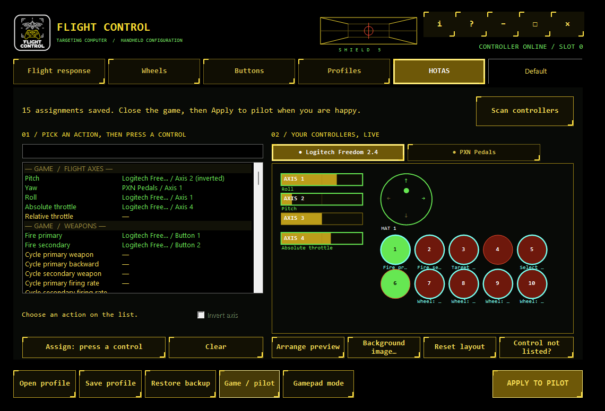
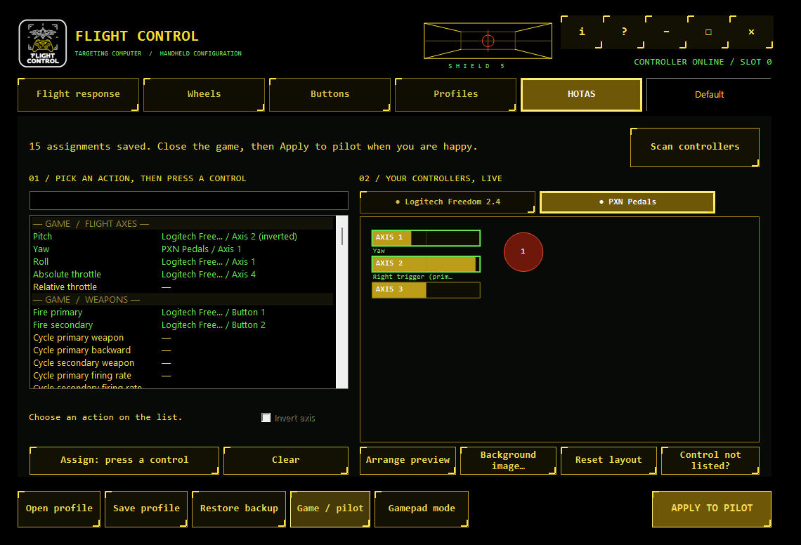
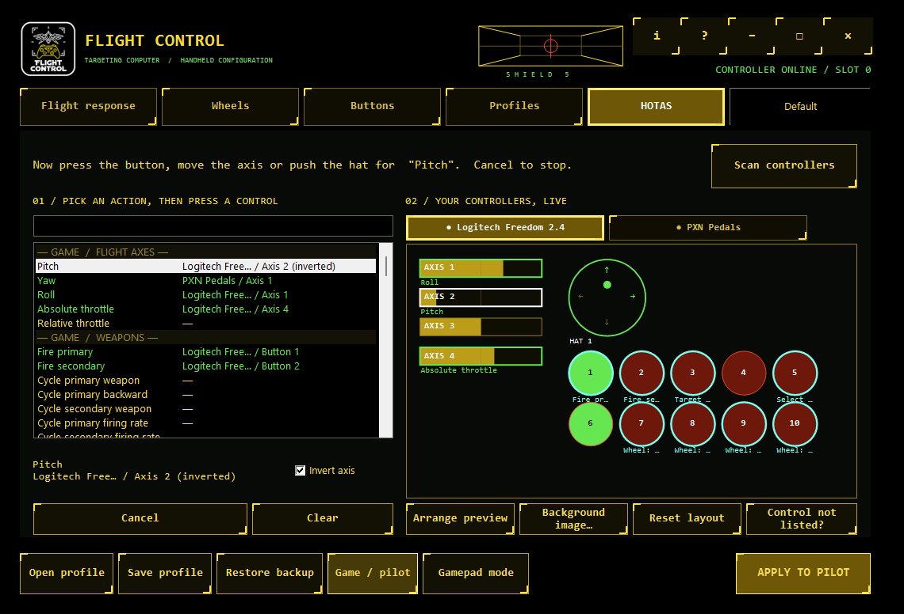
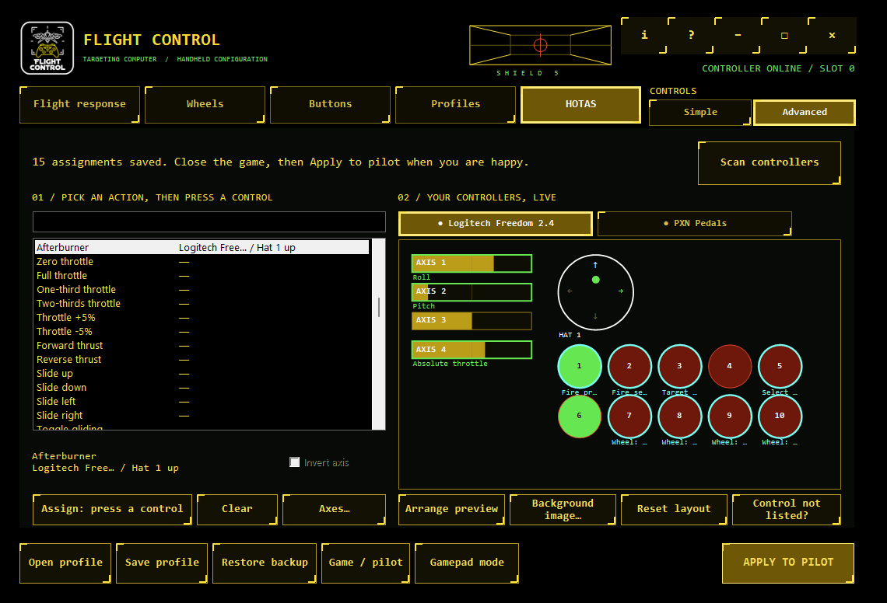
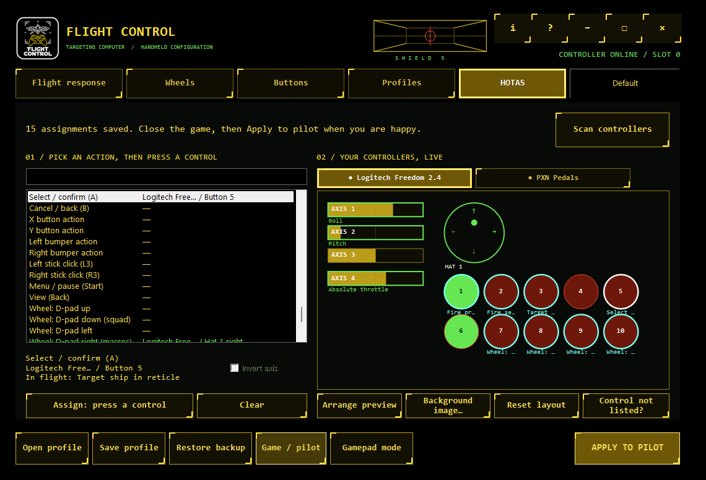
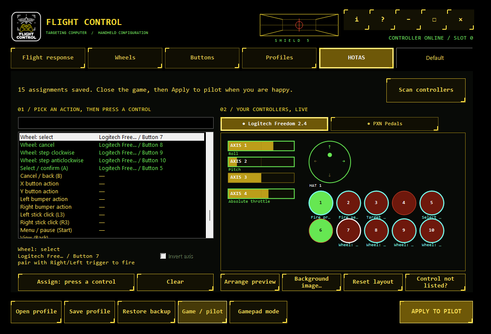
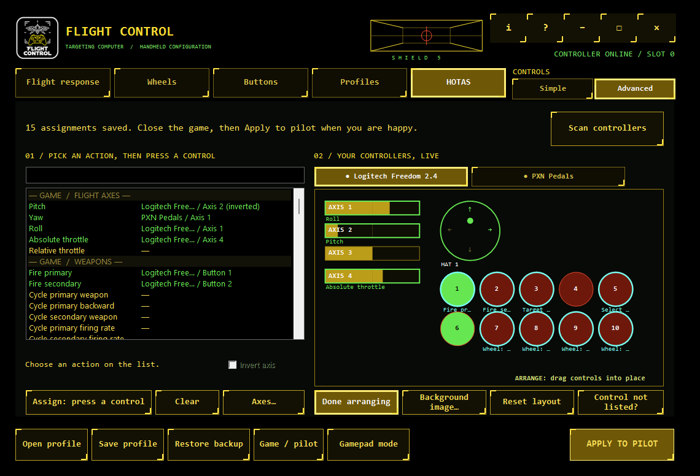
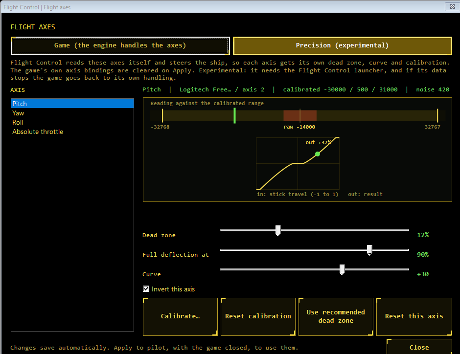
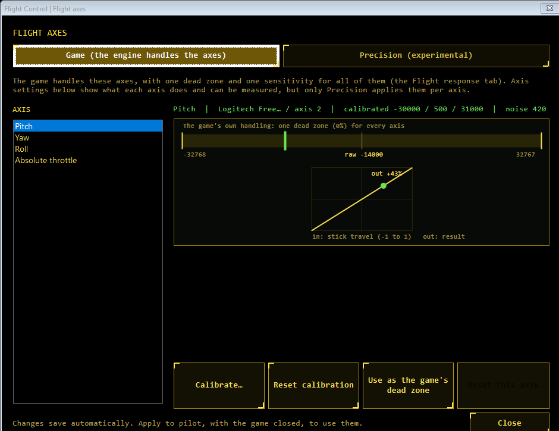

# Flight Control: HOTAS guide (preview)

Fly Fate of the Galaxy 2 with a joystick, throttle and pedals, and keep Flight Control's command wheels. This guide covers the HOTAS tab in the Flight Control Console.

> **Preview.** HOTAS support is new and has been tested with a Logitech Freedom 2.4 and a handheld gamepad. Hats, axes used as buttons, rotary encoders and some of the extra game actions have not been tried on many devices yet. Section 13 lists exactly what is and is not confirmed.

## 1. What you need

- Fate of the Galaxy **2.0.2**, installed through Flight Control (MyMod). Fate of the Galaxy 1.1.x (classic) does not support HOTAS yet.
- Windows 64-bit, and the Flight Control Console and launcher from this build.
- **Controls: Advanced.** HOTAS is an advanced feature, so its tab is greyed out and cannot be clicked until the Controls switch is set to Advanced.
- Any joystick, throttle, pedals or button box that the game's own engine can see. If the game cannot see a control, neither can Flight Control (see section 10).
- Close the game before you press Apply.

## 2. Quick start

1. Open the Flight Control Console and set **Controls** (right end of the tab row) to **Advanced**. The **HOTAS** tab is switched off in Simple. Then choose the **HOTAS** tab. It scans your controllers straight away.
2. Move a control on each device. Its picture lights up, so you can tell which device is which.
3. Pick an action on the left, for example **Pitch**, then move the stick. The assignment is made when the signal is clear.
4. Repeat for the rest of your controls. Click **Control not listed?** if something does not show up.
5. Close the game and press **Apply to pilot**. Launch the game with the Flight Control launcher.

Your work saves itself. You do not need to save a file to keep it.

## 3. The HOTAS tab

**Controllers.** Each connected device has a button along the top, with a dot that is filled while the device is connected. The picture below it shows live values: bars for axes, circles for buttons and a dial for each hat. A device you unplug stays in your profile and comes back when you plug it in again.

**Actions.** The list has two parts.

- **Game** actions are the game's own controls: flight axes, weapons, targeting, throttle and thrust, energy and shields, views, squad and mission commands.
- **Flight Control** actions are the command wheels and gamepad-style buttons: wheel D-pad directions, select and cancel, the face buttons, bumpers, stick clicks, triggers and sticks.

Type in the box above the list to filter it.

**Assigning.** Choose an action, then press the button, move the axis or push the hat on any device. Flight Control listens to all your devices at once and ignores axes that jitter on their own. You can also click a control in the picture to assign it without touching the hardware.

- Axes that you want as a button (a throttle lever used as a switch) work: move the axis towards the side you want.
- **Invert axis** flips an axis.
- **Clear** removes an assignment.

## 4. Two kinds of action

| | Game actions | Flight Control actions |
|---|---|---|
| What they are | The game's own bindings | The wheels, gestures and gamepad-style buttons |
| Where they run | In the game | In the Flight Control launcher, on a virtual gamepad |
| Limits | Four joystick devices; axes 1 to 8; buttons 1 to 128; only the first hat, four directions | None of those |
| Can share one input | No, one input has one job | Yes |

Use game actions for the ship's flying controls and for anything that always does the same thing. Use Flight Control actions for the wheels, and for any button that must do different things at different times.

## 5. One button, different jobs

A gamepad button does one thing in flight and another inside a wheel. You can do the same on a joystick.

- **Wheel: select** and **Wheel: cancel** act only while a wheel is open.
- **Right trigger** and **Left trigger** fire the primary and secondary weapons, and are paused while a wheel is open.

Assign one physical button to **Right trigger** and **Wheel: select**. In flight it fires. In a wheel it confirms and does not fire. Do the same with another button for **Left trigger** and **Wheel: cancel**.

A button that you hold through a selection is ignored in flight until you let go, so choosing an entry does not fire a shot as the wheel closes.

The face buttons, bumpers and stick clicks keep their flight action from the **Buttons** tab, shown under the list when you select one.

**Why not a game action?** The game does not pause its own bindings while a wheel is open, so a button bound to Fire primary in the game would fire while you used the wheel. The HOTAS tab warns you when one input drives both a game action and a Flight Control action.

## 6. Encoder wheels

A rotary encoder usually shows up as two buttons, one pulse per click in each direction. Assign **Wheel: step clockwise** and **Wheel: step anticlockwise**, turning the encoder in each direction when asked. While a wheel is open, each click moves the highlight one entry round the wheel and wraps at the ends. **Wheel: select** confirms.

Fast turning is queued, up to 16 steps, and played back one at a time. Two ordinary buttons work in place of an encoder.

## 7. Several devices

Use as many devices as you have: a stick, a throttle, pedals, a button box. Each device is a button along the top of the preview. Identical devices without serial numbers (two of the same pedals) are told apart by the order Windows lists them. Game actions can use up to four devices. Flight Control actions can use any number.

You can use a gamepad and a HOTAS at the same time. The HOTAS is layered over the gamepad in the launcher.

## 8. The preview

- **Arrange preview** lets you drag each control to where it is on your real device.
- **Background image** adds a picture of your device behind the controls. The picture stays on your PC and is never saved into a shared profile.
- **Reset layout** returns to the automatic arrangement.

## 9. Flight axes: dead zones, curves and calibration

Press **Axes…** (beside Clear) to see and tune your flying axes: pitch, yaw, roll and the throttle. First choose how they are handled.

- **Game.** The game handles the axes, with one dead zone and one sensitivity for every axis (the Flight response tab). Nothing per axis is applied. The dialog still shows each axis live, and **Calibrate…** measures it and can set the game's dead zone for you.
- **Precision (experimental).** Flight Control reads the axes itself and steers the ship through the game script. Each axis gets its own dead zone, curve and calibration. Apply clears the game's own axis bindings so the game does not also act on them.

In Precision, for the axis you pick:

| Setting | What it does |
|---|---|
| Dead zone | The part of the travel around the centre that counts as zero. The rest is stretched to full, so there is no jump when the stick leaves it. A lever has its dead zone at both ends. |
| Full deflection at | How far you have to move before the axis already counts as full. Lower it if the stick cannot quite reach its end stop. |
| Curve | Positive makes the centre gentler and the ends faster, negative the opposite. |
| Invert this axis | Flips the direction. |

The picture shows the reading against the calibrated range, the dead zone in red, and the response curve with a live dot on it.

**Calibrate…** measures the axis in two steps. Leave it alone for two seconds, so Flight Control learns where it rests and how much it wobbles. Then move it through its whole range, to every end, for six seconds. A throttle lever needs only the sweep. The result recentres a worn stick, stretches a short one to full travel, and recommends a dead zone from the wobble. **Use recommended dead zone** applies it, and **Reset calibration** goes back to the full range.

Precision needs the Flight Control launcher and applies only while the game window is in front. If the launcher's data stops, the game goes back to its own handling, which has no axis bindings in Precision, so the ship stops steering until the data returns. Keyboard throttle keys, match speed and the afterburner keep working. Because Precision replaces the game's axis handling, the global dead zone and sensitivity on the Flight response tab no longer apply to these axes.

## 10. When a control is missing

Press **Control not listed?** and use the control. If it lights up, it is listed and ready to assign. If nothing happens, the game cannot see it either. Try another mode on the device, or set the control to a button in the manufacturer's software, then press **Scan controllers**.

## 11. Applying, backups and switching back

**Apply to pilot** writes your assignments for the selected pilot. Close the game first.

- Game actions are written to Flight Control's control table, and your devices are set as the game's joysticks.
- Flight Control actions are written to a small map file that the launcher reads.
- Before anything is changed, a backup is made. **Restore backup** puts back exactly what the last Apply changed.
- If something that was installed is not in your profile any more, Apply tells you before it removes it.

**Gamepad mode** switches the game back to the gamepad: it removes the HOTAS bindings and the map, and puts the pilot's preset and joystick selection back as they were before you first applied HOTAS. Your HOTAS profile is kept, so **Apply to pilot** brings it straight back.

If you apply gamepad settings on the Flight response tab while HOTAS is applied, you are warned first, because that points the game's first joystick at the gamepad. If it happens, the HOTAS tab tells you the slots no longer match and Apply re-syncs them.

Applying only Flight Control actions never touches the pilot's preset, the control table or the game's joysticks, so a gamepad setup keeps working beside a HOTAS used only for wheels and buttons.

## 12. Sharing profiles

- **Save profile** writes a `.fchotas` file. It contains your assignments, device names and layout. It does not contain device serial numbers or any picture path.
- **Open profile** loads one. Anything personal is stripped, the file is checked, and your own profile is kept as a backup first.
- A shared profile matches your hardware by device model. For a different model, right-click a device button along the top and choose one of your own devices to use in its place.
- Wheel layouts, macros and button actions live in the **Profiles** tab and are shared separately. A HOTAS setup that relies on a button's quick-press action needs that profile too.

## 13. What is confirmed

Confirmed in the game: joystick axes and buttons as game actions, several devices at once, Flight Control wheels driven from a joystick, one button with different jobs by state.

Not yet confirmed on many devices: game actions on a hat, axes used as buttons, inverted axes, the extra game actions beyond fire, targeting and weapons, rotary encoders, and Precision flight axes (calibration, dead zones and curves). If one of these misbehaves, please report it (see below).

Not available: Fate of the Galaxy 1.1.x, hats other than the first for game actions, and diagonal hat directions for game actions (they work for Flight Control actions).

## 14. Troubleshooting

| What you see | What to do |
|---|---|
| "Select your FotG 2 installation first" | Use **Game / pilot** at the bottom and pick the game folder and a pilot. |
| The ship drifts or twitches at rest in Precision | Open **Axes…**, calibrate that axis and use the recommended dead zone. |
| A button fires while a wheel is open | That button is bound to a game action. Use **Right trigger** and **Wheel: select** instead (section 5). |
| "The game's joystick slots no longer match" | Press **Apply to pilot** again, with the game closed. |
| The picture is empty | Press **Scan controllers**. Plug in the device first. |
| Apply fails | The Console writes the details to `console-error.log` next to it. Send that with your report. |
| You want the gamepad back | Press **Gamepad mode**. |

## 15. Reporting a problem

Tell us which device, which control, what you assigned, and what happened. Include `console-error.log` if Apply failed. Send reports to dev@manictrashpanda.dev.

### Diagnostic report

If a control works in the Flight Control tab but not in the game (a throttle that works for a moment and then stops, for example), record a diagnostic flight. It gives us what we need to see.

1. Close the game. Open **Hangar Bay** and choose **05 Diagnose**, then **Start diagnostic flight**. The game starts as usual.
2. Start a mission and fly. With the lever fully **forward** press **F8**. With it fully **back** press **F7**. Whenever something looks wrong, press **F9**. The keys work while the game is in front.
3. Quit the game. A ZIP report is built and shown in Explorer, in the folder **Flight Control Diagnostics** in your game folder.

The report records what your devices report, what Flight Control sent, the game's own bindings for the joystick axes, and the throttle the ship really had. It also copies your HOTAS profile and the control settings the game uses, without serial numbers, your Windows user name or your pilot's name. Nothing is sent anywhere. Look through the ZIP before you share it, then send it to dev@manictrashpanda.dev.
